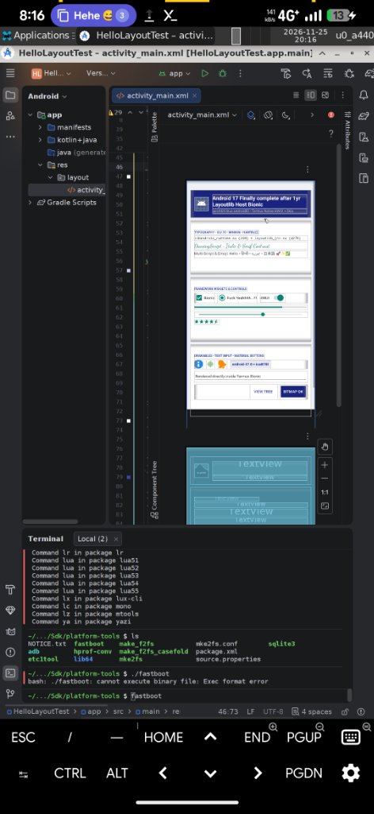

<div align="center">

# libandroidruntime-host-bionic

**AOSP Android 17 (`android-17.0.0_r1`) `libandroid_runtime.so` and `layoutlib_jni.so` compiled natively for ARM64 Android Bionic (`aarch64-linux-android30`)**

[-3DDC84?style=flat-square&logo=android&logoColor=white)](https://termux.dev)
[](STATUS.md)
[](map/aosp-17-default.xml)
[](cmake/toolchain.cmake)
[](https://github.com/sirvkrm/libandroidruntime-host-bionic/releases)

[Quick Install](#quick-install-termux) · [Proof of Work](#proof-of-work) · [Verified ELF Output](#verified-elf--api-30-results) · [Build Architecture](#build-architecture) · [Build Notes](notes/) · [Main IDE Installer](https://github.com/sirvkrm/AndroidStudio-For-Android)

</div>

---

## Overview

This repository isolates and builds Android's native host Layoutlib runtime (`libandroid_runtime.so` and `layoutlib_jni.so`) from AOSP **`android-17.0.0_r1`** directly against **Android Bionic (`aarch64-linux-android30`, NDK r28c)** instead of Linux `glibc`.

It exists so desktop Android Studio running natively inside Termux on Android phones/tablets can execute the **Split / Design XML Layout Editor** and standalone `layoutlib` rendering pipelines without `proot`, `chroot`, or a `glibc` compatibility layer.

> Full AOSP source checkouts (`src/`) and intermediate build directories (`build/`, `out/`) are excluded from Git history; prebuilt stripped ARM64 Bionic binaries and test harnesses are published under [**GitHub Releases**](https://github.com/sirvkrm/libandroidruntime-host-bionic/releases).

---

## Proof of Work

Running live inside Android Studio Rabbit 1 (`2026.2.1.8`) directly on Termux Bionic ARM64 (Split view rendering typography via ICU 78 / Minikin / HarfBuzz, widgets, drawables, bitmap output, and Blueprint inspector):

<div align="center">
  
</div>

---

## Quick Install (Termux)

If you want the complete Android Studio + SDK + NDK + Skiko + Layoutlib Bionic setup, use the interactive installer in [**sirvkrm/AndroidStudio-For-Android**](https://github.com/sirvkrm/AndroidStudio-For-Android).

To install or update only the **precompiled ARM64 Bionic Layoutlib native binaries** and standalone CLI test harness (`layoutlib-test`) on Termux:

```bash
curl -fsSL https://raw.githubusercontent.com/sirvkrm/libandroidruntime-host-bionic/main/tools/termux/install.sh | bash
```

Then run verification on-device:

```bash
layoutlib-test smoke   # Native dlopen + JNI_OnLoad + HostProperties check
layoutlib-test xml     # Inflate & render XML layout via Android Studio layoutlib.jar -> PNG
```

When launching Android Studio on-device, make sure the custom `layoutlib/data/linux/lib64` directory precedes `/system/lib64` in `LD_LIBRARY_PATH` so the IDE loads this host Bionic `libandroid_runtime.so` rather than Android's restricted framework library:

```bash
LAYOUTLIB_NATIVES="$STUDIO_DIR/plugins/design-tools/resources/layoutlib/data/linux/lib64"
export LD_LIBRARY_PATH="$LAYOUTLIB_NATIVES:/system/lib64:$PREFIX/lib:$LD_LIBRARY_PATH"
```

---

## Verified ELF & API 30 Results

Verified against NDK r28c (`llvm-readelf`, `llvm-nm`, and `sysroot/usr/lib/aarch64-linux-android/30/{libc,libm,libdl}.so`) and tested live in Termux:

| Artifact | Stripped Size | Unstripped Size | `DT_NEEDED` Dependencies | Notes |
| :--- | :---: | :---: | :--- | :--- |
| **`libandroid_runtime.so`** | `~19–20 MB` | `~335 MB` | `libm.so`, `libdl.so`, `libc.so` | `SONAME: libandroid_runtime.so`, `229` defined dynamic exports, `0` missing strong symbols at API 30 |
| **`layoutlib_jni.so`** | `~433 KB` | `~5.6 MB` | `libandroid_runtime.so`, `libdl.so`, `libm.so`, `libc.so` | `SONAME: layoutlib_jni.so`, `DT_RUNPATH: [$ORIGIN]`, `0` missing strong symbols at API 30 |
| **`icudt78l.dat`** | `~29 MB` | — | Data asset | AOSP 17 ICU 78 data matching `libandroid_runtime.so` (also compatible with Rabbit 1 bundled ICU) |

### Key Host-Bionic Engineering Adaptations

1. **In-Process `HostProperties` under `__BIONIC__`** ([`patches/05_host_bionic_libbase_properties.patch`](patches/05_host_bionic_libbase_properties.patch)): AOSP normally gates in-memory property storage behind `#if !defined(__BIONIC__)`. Because unrooted Termux cannot write `/dev/socket/property_service` (`EACCES`), strong C definitions for `__system_property_{set,get,find,read,...}` route `Bridge.setSystemProperties()` calls cleanly inside the process.
2. **Host Graphics Include Ordering & Stubs** ([`cmake/runtime.cmake`](cmake/runtime.cmake), [`patches/03_host_bionic_frameworks_ui.patch`](patches/03_host_bionic_frameworks_ui.patch)): Ensures `frameworks/base/libs/hostgraphics/include` overrides device HAL graphics headers cleanly (`libhostgraphics`, `libnativehelper_jvm`, `libhwui`).
3. **Synchronized CXX Bridge ABI (`1.0.119`)** ([`tools/build_rust.py`](tools/build_rust.py)): Rebuilds `cxxbridge` (`1.0.119`) and regenerates FFI C++/Rust bridges (`minikin`, `skia` fontations, `libinput`, `aconfig_storage_read_api`, `libflags`) so C++ and Rust symbols agree cleanly.
4. **Core JNI Host Guards & RTTI Exports** ([`patches/04_host_bionic_core_jni.patch`](patches/04_host_bionic_core_jni.patch)): Guards device-only Binder/ashmem/Surface/Hyphenator paths for `LAYOUTLIB_HOST`, exports `AndroidRuntime` RTTI across DSO boundaries, and skips non-applicable device JNI table entries safely during `register_jni_procs`.

---

## Build Architecture

All Soong `Android.bp` graphs were analyzed via [`tools/bp_mapper.py`](tools/bp_mapper.py) / [`tools/bp_parser.py`](tools/bp_parser.py) and lowered into modular CMake targets + Rust staticlibs:

| Module Group | Description | File |
| :--- | :--- | :--- |
| Top-level CMake | Master orchestration & host codegen gate | [`CMakeLists.txt`](CMakeLists.txt) |
| NDK r28 Toolchain | `aarch64-linux-android30`, `c++_static`, host Bionic defs | [`cmake/toolchain.cmake`](cmake/toolchain.cmake) |
| Third-Party Stack | `zlib`, `png`, `jpeg`, `expat`, `fmt`, `webp`, `freetype`, `abseil`, `re2`, `tflite`, `jxl`, `ultrahdr`, etc. | [`cmake/third_party.cmake`](cmake/third_party.cmake) |
| System Core & Binder | `liblog`, `libbase`, `libcutils`, `libutils`, `libziparchive`, `libbinder`, `libaconfig_*` | [`cmake/system_core.cmake`](cmake/system_core.cmake) |
| Text, ICU, SQLite & Skia | `libicu`, `harfbuzz`, `libsqlite`, `libminikin`, `libskia` | [`cmake/graphics_text.cmake`](cmake/graphics_text.cmake) |
| UI, Input & HWUI | `libandroidfw`, `libinput`, `libhwui`, `libhostgraphics`, `libperfetto_c` | [`cmake/frameworks_ui.cmake`](cmake/frameworks_ui.cmake) |
| Runtime & Layoutlib JNI | `libandroid_runtime.so` and `layoutlib_jni.so` link rules | [`cmake/runtime.cmake`](cmake/runtime.cmake) |
| Rust FFI Archives | Cargo build script for `minikin`, `skia`, `input`, `aconfig` + `cxxbridge` | [`tools/build_rust.py`](tools/build_rust.py) |
| Phase Build Notes | Detailed engineering logs for Phases 1–7 | [`STATUS.md`](STATUS.md), [`notes/`](notes/) |

---

## Related Repositories

- [**sirvkrm/AndroidStudio-For-Android**](https://github.com/sirvkrm/AndroidStudio-For-Android) — Interactive 1-command Termux installer bundling Rabbit 1 IDE, SDK, NDK, `aapt2`, Skiko, and this Layoutlib runtime.
- [**sirvkrm/AndroidStudio-Bionic-Libs**](https://github.com/sirvkrm/AndroidStudio-Bionic-Libs) — Native Bionic `fsnotifier`, `pty4j`, `libutil`, `jna`, `sqlite-jdbc`, `skiko`, and `studio-bionic-fs.jar` file-chooser agent.
- [**sirvkrm/skiko-android**](https://github.com/sirvkrm/skiko-android) — JetBrains Skiko (`bionic-v0.144.5`) adapted for Termux Bionic OpenJDK & X11/OpenGL rendering.
